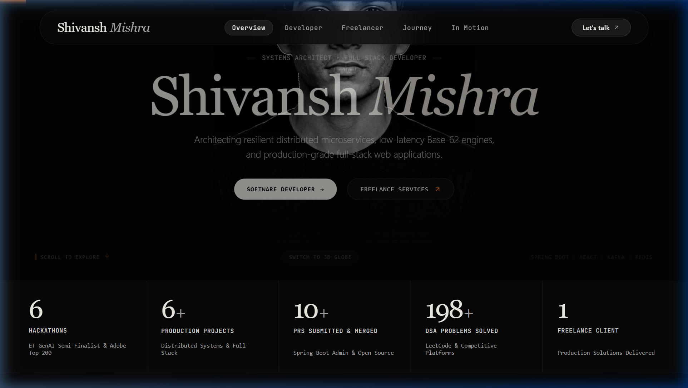
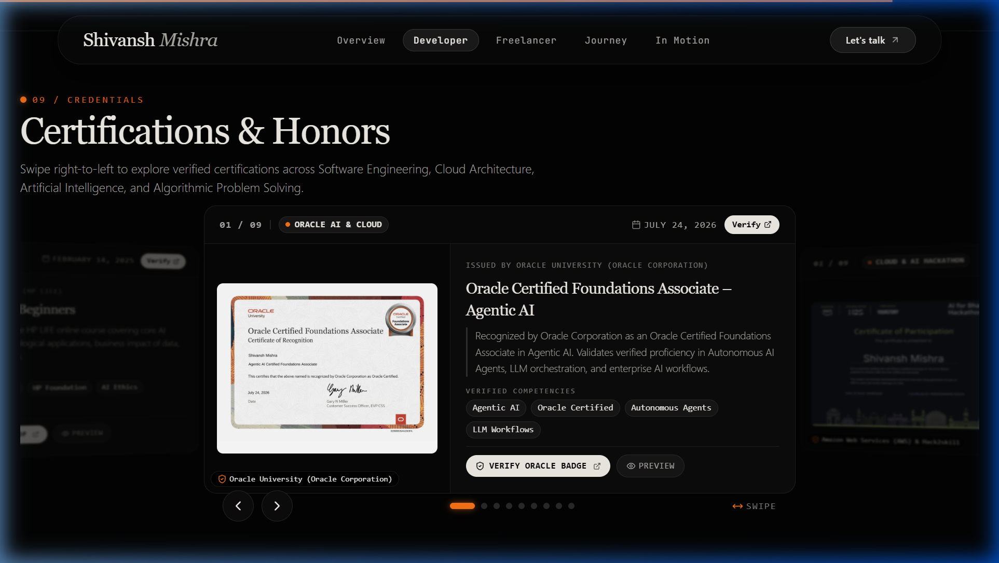
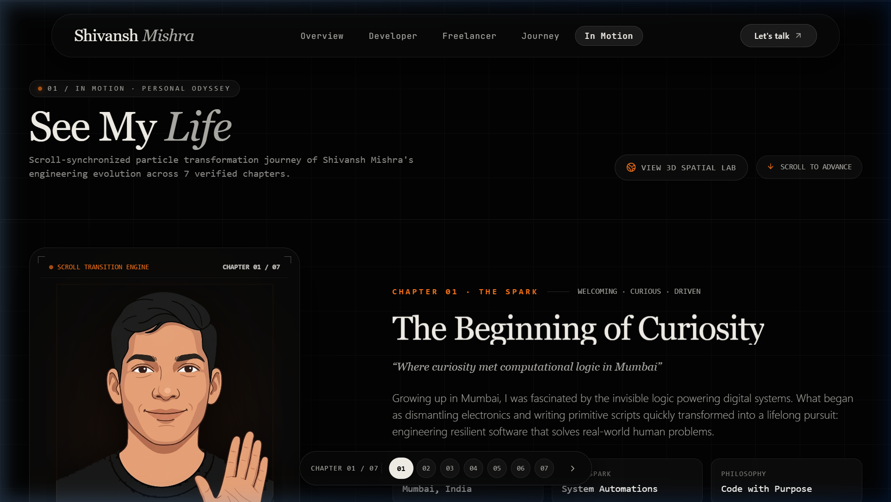
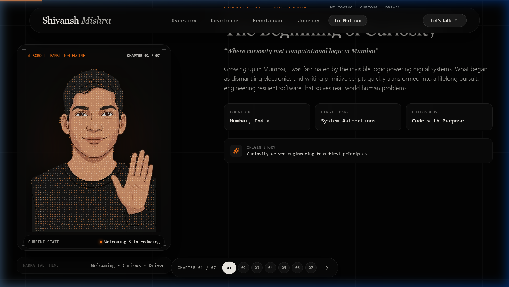

<div align="center">

# Shivansh Mishra — Personal Portfolio

<p align="center">
  <strong>Systems Architect · Full-Stack Developer · Freelance Engineer</strong>
</p>

<p align="center">
  A premium, editorial monochrome, 3D-enhanced portfolio built with <strong>Next.js 14 App Router</strong>, <strong>React 18</strong>, <strong>Tailwind CSS</strong>, and a custom <strong>Canvas 3D Particle Engine</strong>.
</p>

[](https://shivansh-mishra.netlify.app)
[](https://nextjs.org/)
[](https://reactjs.org/)
[](https://tailwindcss.com/)
[](#license)

<br />

**[Explore Live Portfolio ↗](https://shivansh-mishra.netlify.app)** &nbsp;•&nbsp; **[Engineering Profile ↗](https://shivansh-mishra.netlify.app/developer)** &nbsp;•&nbsp; **[Freelance Services ↗](https://shivansh-mishra.netlify.app/freelancer)** &nbsp;•&nbsp; **[In Motion 3D Odyssey ↗](https://shivansh-mishra.netlify.app/3d-lab)**

</div>

---

## 📸 Visual Showcase

### 1. Editorial Hero & Overview (`/`)
The homepage delivers an immediate, restrained editorial statement featuring the crisp portrait, ambient warm rim glow, real-time kinetic proof strip, and audience path switchers.

<div align="center">
  
</div>

<br />

### 2. Compact 3D Circular Card Deck (`/developer#certifications`)
A responsive, non-clipped 3D circular carousel featuring verified industry credentials from Oracle, AWS, HP, and HackerRank, complete with interactive preview modals and credential verification links.

<div align="center">
  
</div>

<br />

### 3. In Motion — 7-Chapter Particle Odyssey (`/3d-lab`)
Scroll-synchronized particle transformation journey tracking Shivansh's software engineering evolution across 7 verified chapters. Features fine particle physics, delicate warm coronas, and reverse-scroll reconstruction.

<div align="center">
  
  &nbsp;
  
</div>

---

## 🌟 Key Architectural Features

### 🏛️ Dual-Path Brand Experience
A single personal brand designed for two distinct audiences without dilute messaging:
- **Developer Path (`/developer`)**: Tailored for engineering recruiters and peer architects. Covers distributed systems architecture, Java/Spring Boot microservices, Base-62 URL encoding engines, LeetCode (198+ solved), competitive profiles, and certifications.
- **Freelancer Path (`/freelancer`)**: Tailored for prospective clients and founders. Outlines technical capabilities, project delivery process, estimated timelines/budgets, and structured inquiry briefs.

### 🌌 Scroll-Synchronized Particle Engine
Built directly in vanilla Canvas with mathematical precision:
- **Subtle Point Scaling**: Fine particles (`0.85px - 1.25px`) with high-DPI scaling.
- **Dynamic Physics**: Fluid dispersion, velocity decay, and reverse-scroll target re-convergence.
- **Pose Morphing**: Alpha-sampled character cutouts representing 7 distinct chapters of engineering milestones.

### ⚡ Fast Edge Routing & Redirects
Sub-10ms edge redirects configured at both the Next.js runtime and Netlify global CDN edge:
- `/in-motion` $\rightarrow$ `/3d-lab` (301)
- `/certifications` $\rightarrow$ `/developer#certifications` (301)
- `/resume` & `/cv` $\rightarrow$ `/Shivansh_Mishra_resume_f1.pdf` (302)
- `/github`, `/linkedin`, `/leetcode` $\rightarrow$ direct verified profiles (302)
- Asset headers: Long-term immutable caching (`public, max-age=31536000, immutable`) for static chunks and character cutouts.

### 🔍 Search Engine Optimization (SEO) & Schema Graph
- **Schema.org JSON-LD**: Embedded `Person`, `WebSite`, and `ProfilePage` structured data graph in `RootLayout`.
- **Dynamic Sitemap & Robots**: Next.js App Router dynamic sitemap (`src/app/sitemap.js`) and robots generator (`src/app/robots.js`) referencing the canonical domain.
- **Social Graph**: OpenGraph and Twitter `summary_large_image` cards configured for every page.

### 📬 Context-Aware Contact System
- Adaptive modal switching between Client Project Inquiries and Developer Discussions.
- Direct JSON submission to the **Web3Forms API** with instant feedback and toast confirmations.

---

## 🗺️ Verified Route Map

| Route | Canonical Path | Target Audience & Content |
|---|---|---|
| **Overview** | [`/`](https://shivansh-mishra.netlify.app/) | Brand overview, kinetic proof strip, selected work preview, path selector |
| **Developer** | [`/developer`](https://shivansh-mishra.netlify.app/developer) | Distributed systems, Spring Boot stack, coding profiles, 3D certificates deck |
| **Freelancer** | [`/freelancer`](https://shivansh-mishra.netlify.app/freelancer) | Client services, case studies, workflow, interactive inquiry brief |
| **Journey** | [`/journey`](https://shivansh-mishra.netlify.app/journey) | Chronological milestone timeline from early code to production microservices |
| **In Motion** | [`/3d-lab`](https://shivansh-mishra.netlify.app/3d-lab) | 7-scene narrative character odyssey with scroll-driven particle transformation |

---

## 💻 Tech Stack

- **Framework**: [Next.js 14.2](https://nextjs.org/) (App Router, Server Components & Static Site Generation)
- **UI & State**: [React 18](https://reactjs.org/)
- **Styling**: [Tailwind CSS v3](https://tailwindcss.com/) & SCSS modules
- **Typography**: Instrument Serif, Inter, JetBrains Mono
- **Animations**: [Framer Motion](https://www.framer.com/motion/) & [Lenis](https://lenis.darkroom.engineering/)
- **Graphics & 3D**: Vanilla Canvas Particle Engine & [Three.js](https://threejs.org/)
- **Icons**: [Lucide React](https://lucide.dev/) & [React Icons](https://react-icons.github.io/react-icons/)
- **Form API**: [Web3Forms](https://web3forms.com/)
- **Deployment**: [Netlify](https://www.netlify.com/) with `@netlify/plugin-nextjs`

---

## 🛠️ Local Setup & Development

### Prerequisites
- **Node.js**: v18.17.0 or higher
- **npm**: v9+ or equivalent package manager

### 1. Clone & Install
```bash
git clone https://github.com/shivanshmishra54/Portfolio.git
cd Portfolio
npm install
```

### 2. Configure Environment Variables
Create a `.env` file in the project root:
```env
NEXT_PUBLIC_WEB3FORMS_ACCESS_KEY=your_web3forms_access_key
```

### 3. Run Locally
```bash
# Start Next.js development server
npm run dev

# Or test the optimized production build locally:
npm run build
npm start
```
Open [http://localhost:3000](http://localhost:3000) in your browser.

### 4. Lint & Validate
```bash
npm run lint
```

---

## 👤 Author & Socials

**Shivansh Mishra**  
*Systems Architect · Full-Stack Developer · B.Tech IT at K.J. Somaiya Institute of Technology*

- **Website**: [shivansh-mishra.netlify.app](https://shivansh-mishra.netlify.app)
- **GitHub**: [@shivanshmishra54](https://github.com/shivanshmishra54)
- **LinkedIn**: [linkedin.com/in/shivansh-mishra54](https://www.linkedin.com/in/shivansh-mishra54)
- **LeetCode**: [leetcode.com/u/shivanshmishra54](https://leetcode.com/u/shivanshmishra54/)
- **YouTube**: [@ShivanshMishra54](https://www.youtube.com/@ShivanshMishra54)
- **Email**: [shivansh54mishra@gmail.com](mailto:shivansh54mishra@gmail.com)

---

## 📝 License

This project is proprietary and customized for Shivansh Mishra's personal brand and portfolio.

<div align="center">
  <sub>Designed & Developed with precision by Shivansh Mishra. © 2026 All Rights Reserved.</sub>
</div>
