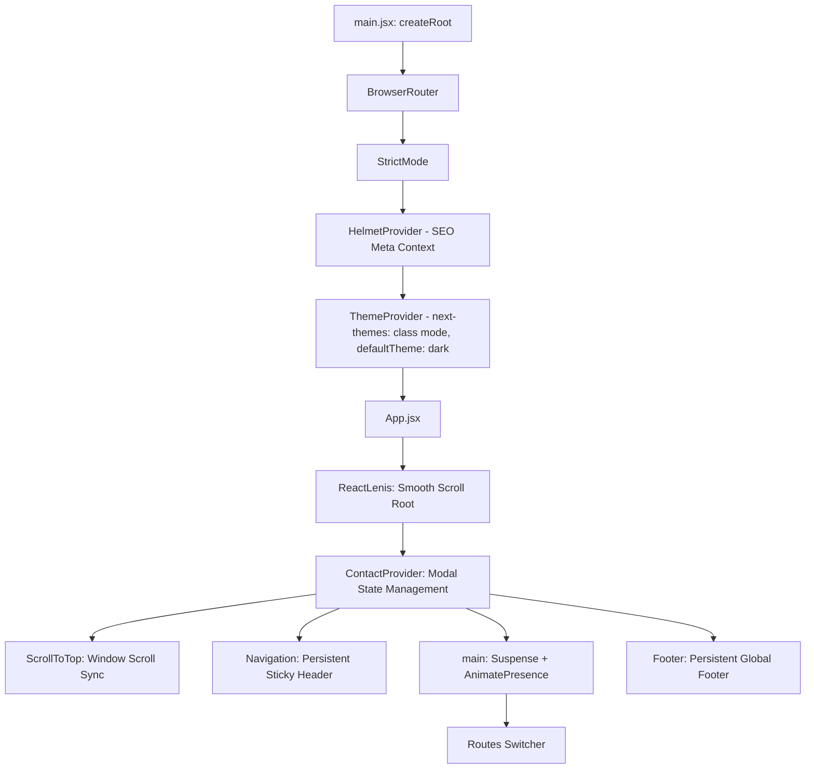
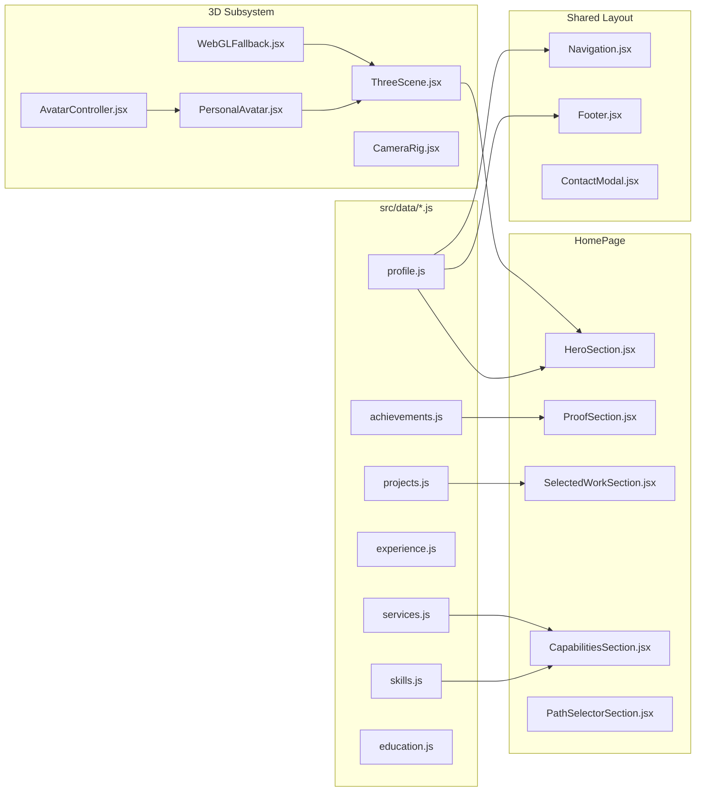

# 01 — Repository Identity & Application Architecture

> **Audit Date:** October 26, 2026  
> **Auditor Role:** Senior Software Engineer, Frontend Architect, UI/UX Auditor, Accessibility Specialist, SEO Analyst, Deployment Engineer  
> **Project Owner:** Shivansh Mishra  
> **Repository:** `https://github.com/shivanshmishra54/Portfolio`  
> **Live Site:** `https://shivansh-mishra.netlify.app/`

---

## 1. Repository Identity & Working-Tree State

### 1.1 Git Verification [VERIFIED FROM SOURCE]
- **Repository Root:** `c:\Project\Portfolio\portfolio`
- **Remote Origin URL:** `https://github.com/shivanshmishra54/Portfolio.git` (matches designated portfolio repository)
- **Active Branch:** `main` (tracked with `origin/main`)
- **Latest Commit:** `3e205f5 Merge remote-tracking branch 'origin/main'`
- **Prior Recent Commits:**
  - `7dacb10`: *feat: hero layout elevation with interactive 3D skills globe, mobile gyroscope, and responsive UI updates*
  - `2f1b4f4`: *Merge pull request #1 from shivanshmishra54/feat/3d-foundation*

### 1.2 Working Tree Status & Uncommitted State [VERIFIED FROM SOURCE]
The repository currently contains 12 modified tracked files and 7 untracked files/directories prior to this audit:
- **Modified Tracked Files:**
  1. `package.json` (added locomotive-scroll, sass, animejs, gsap, lenis, next-themes, prismjs, react-icon-cloud, react-icons, etc.)
  2. `package-lock.json`
  3. `src/App.jsx` (editorial SCSS import, dark aesthetic container, route definitions)
  4. `src/components/layout/Footer.jsx` (dark background styling `#030303`, social link mapping)
  5. `src/components/layout/Navigation.jsx` (Instrument Serif branding, SignalText micro-interaction, Let's talk modal trigger)
  6. `src/data/achievements.js` (credibility metric counts: 6 hackathons, 6 projects, 10+ PRs, 200+ DSA, 1 client)
  7. `src/data/profile.js` (editorial photo pointer, B.Tech 8.72 CGPA data)
  8. `src/main.jsx` (ThemeProvider defaultTheme="dark", StrictMode, HelmetProvider)
  9. `src/pages/HomePage/AboutSection.jsx` (editorial typography & stats integration)
  10. `src/pages/HomePage/HeroSection.jsx` (portrait backdrop toggle, LineMaskReveal, SignalText)
  11. `src/pages/HomePage/SelectedWorkSection.jsx` (curated projects layout)
  12. `src/pages/HomePage/index.jsx` (homepage composition)
- **Untracked Additions:**
  1. `public/hero-editorial.webp` (144.3 KB portrait image asset)
  2. `src/components/ui/KineticProofStrip.jsx` (ticker animation)
  3. `src/components/ui/LineMaskReveal.jsx` (editorial line mask reveal)
  4. `src/components/ui/PerspectiveSwitcher.jsx` (dual perspective switch component)
  5. `src/components/ui/SignalText.jsx` (Anime.js character scramble effect)
  6. `src/components/ui/TypographicMarquee.jsx` (GSAP powered text marquee)
  7. `src/styles/editorial.scss` (custom SCSS design system tokens)
  8. `docs/portfolio-audit/` (Audit documentation and screenshots directory)

---

## 2. Directory Map & File Inventory

The repository is organized as a single-page application (SPA) built with Vite and React 18:

```
portfolio/
├── .env                              # Public client environment variables (VITE_WEB3FORMS_ACCESS_KEY)
├── .gitignore                        # Git exclusion rules
├── AGENTS.md                         # Permanent operating contract & constraints
├── README.md                         # Documentation & project overview
├── components.json                   # shadcn/ui configuration
├── eslint.config.js                  # Flat ESLint 9 configuration
├── fix-eslint.js                     # Scratch Node repair script (fails ESLint no-undef)
├── index.html                        # HTML5 entrypoint with dynamic SVG favicon
├── jsconfig.json                     # Path alias resolution (@/* -> src/*)
├── package.json                      # Dependency manifests & scripts
├── package-lock.json                 # Lockfile (npm v10+)
├── postcss.config.js                 # PostCSS pipeline (Tailwind CSS, Autoprefixer)
├── tailwind.config.js                # Tailwind CSS v3 configuration
├── vercel.json                       # Vercel deployment rewrites (/* -> /index.html)
├── vite.config.js                    # Vite 7 build configuration with Rollup chunking
├── public/                           # Static assets served at root
│   ├── _redirects                    # Netlify SPA rewrite rule (/* /index.html 200)
│   ├── favicon-dark.svg              # Dark mode vector favicon (303 B)
│   ├── favicon-light.svg             # Light mode vector favicon (303 B)
│   ├── hero.webp                     # Original portrait photo (20.4 KB)
│   ├── hero-editorial.webp           # High-resolution editorial portrait (144.4 KB)
│   ├── robots.txt                    # Crawler directives
│   ├── sitemap.xml                   # XML sitemap
│   ├── Shivansh_Mishra_resume_f1.pdf # Full resume download (155.2 KB)
│   ├── certificates/                 # 14 certificate PDFs and WebP thumbnails
│   └── models/
│       └── avatar.glb                # Massive 3D avatar GLB model (14.07 MB)
├── src/
│   ├── App.jsx                       # Main application shell, Lenis scroll root, routing & providers
│   ├── main.jsx                      # DOM mount point, StrictMode, BrowserRouter, HelmetProvider, ThemeProvider
│   ├── assets/
│   │   ├── css/
│   │   │   ├── Header.css            # Legacy header styling
│   │   │   ├── index.css             # Tailwind base/utilities + shadcn HSL variables + legacy keyframes
│   │   │   └── tomorrow.css          # Prism code highlighting theme
│   │   └── react.svg                 # Default unused React template logo
│   ├── components/
│   │   ├── 3d/                       # Three.js / React Three Fiber scene components (11 files)
│   │   ├── globe.jsx                 # Legacy standalone canvas globe
│   │   ├── layout/                   # Layout wrappers: Navigation, Footer, SEOHead, ScrollToTop, etc.
│   │   ├── shared/                   # SectionHeading reusable component
│   │   └── ui/                       # UI primitives: shadcn buttons/cards, modals, animations, tickers (22 files)
│   ├── data/                         # Pure JavaScript single source of truth for portfolio data (12 files)
│   │   ├── achievements.js           # Hackathon, LeetCode, and credibility metrics
│   │   ├── certificates.js           # 10 verified certifications with credentials & dates
│   │   ├── education.js              # Academic records (B.Tech, Class XII topper, Class X)
│   │   ├── experience.js             # Open source (Spring Boot Admin PR #5738), internships, hackathons
│   │   ├── index.js                  # Central data export barrel
│   │   ├── journey.js                # Chronological milestones (2020 - 2026)
│   │   ├── navigation.js             # Nav link definitions
│   │   ├── platforms.js              # Competitive coding profiles (LeetCode, CodeChef, Codeforces)
│   │   ├── profile.js                # Personal identity, bio, contact, social links
│   │   ├── projects.js               # 4 primary dual-path featured projects
│   │   ├── services.js               # Freelancer service offerings, process steps, capabilities
│   │   └── skills.js                 # 6 skill categories with brand icon mappings
│   ├── lib/
│   │   └── utils.js                  # clsx + twMerge utility function (`cn`)
│   ├── services/
│   │   └── platformStats.js          # Client-side API fetchers for LeetCode, CodeChef, Codeforces
│   └── styles/
│       └── editorial.scss            # Custom SCSS tokens, font definitions, and status pulsars
└── docs/                             # Repository specifications, plans, and audit documentation
```

---

## 3. Technology Stack & Framework Verification

| Layer | Declared / Detected Technology | Exact Version | Verification Source |
|---|---|---|---|
| **Build Tool** | Vite | `7.1.3` | [VERIFIED FROM SOURCE] `package.json:55` |
| **Core Framework** | React | `18.3.1` | [VERIFIED FROM SOURCE] `package.json:29` |
| **DOM Renderer** | React DOM | `18.3.1` | [VERIFIED FROM SOURCE] `package.json:30` |
| **Routing** | React Router DOM | `7.8.2` | [VERIFIED FROM SOURCE] `package.json:34` |
| **CSS Framework** | Tailwind CSS | `3.4.19` | [VERIFIED FROM SOURCE] `package.json:54` |
| **CSS Preprocessor** | Sass | `1.106.1` | [VERIFIED FROM SOURCE] `package.json:35` |
| **PostCSS** | PostCSS + Autoprefixer | `8.5.6` / `10.4.21` | [VERIFIED FROM SOURCE] `package.json:46, 52` |
| **Theme System** | next-themes | `0.4.6` | [VERIFIED FROM SOURCE] `package.json:27` |
| **3D Rendering** | Three.js | `0.186.1` | [VERIFIED FROM SOURCE] `package.json:38` |
| **R3F Wrapper** | @react-three/fiber | `8.18.0` | [VERIFIED FROM SOURCE] `package.json:16` |
| **3D Helpers** | @react-three/drei | `9.122.0` | [VERIFIED FROM SOURCE] `package.json:15` |
| **UI Motion** | Framer Motion | `12.23.12` | [VERIFIED FROM SOURCE] `package.json:22` |
| **Timeline Motion** | GSAP | `3.15.0` | [VERIFIED FROM SOURCE] `package.json:23` |
| **Micro-Animations** | Anime.js | `4.5.0` | [VERIFIED FROM SOURCE] `package.json:18` |
| **Smooth Scroll** | Lenis (`lenis/react`) | `1.3.10` | [VERIFIED FROM SOURCE] `package.json:24` |
| **Icons** | Lucide React + React Icons | `0.542.0` / `5.5.0` | [VERIFIED FROM SOURCE] `package.json:26, 33` |
| **SEO Head** | react-helmet-async | `3.0.0` | [VERIFIED FROM SOURCE] `package.json:31` |
| **Syntax Highlighting**| Prism.js | `1.30.0` | [VERIFIED FROM SOURCE] `package.json:28` |
| **Deployment Targets**| Netlify (active) + Vercel | N/A | [VERIFIED IN BROWSER] `_redirects`, `vercel.json` |

---

## 4. Complete Application Architecture

### 4.1 Entry Point & Provider Chain
The application initializes in `src/main.jsx` and wraps the core root in four cascaded providers:


### 4.2 Route Hierarchy & Page Architecture
All routes use `React.lazy()` code-splitting inside `src/App.jsx:13-17`:

| Path | Element / Component | Source File | Purpose |
|---|---|---|---|
| `/` | `<HomePage />` | `src/pages/HomePage/index.jsx` | Cinematic overview, hero, proof strip, selected work, capabilities, path chooser |
| `/freelancer` | `<FreelancerPage />` | `src/pages/FreelancerPage/index.jsx` | Client-focused services, deliverables, 5-step process, pricing, inquiry form |
| `/developer` | `<DeveloperPage />` | `src/pages/DeveloperPage/index.jsx` | Engineering deep-dive: architecture, Spring Boot microservices, LeetCode stats |
| `/journey` | `<JourneyPage />` | `src/pages/JourneyPage/index.jsx` | Interactive chronological timeline from 2020 (SSC) to 2026 (Open Source/Degree) |
| `/3d-lab` | `<ThreeLab />` | `src/pages/Lab/ThreeLab.jsx` | Isolated testbench for 3D shaders, GLB model inspect, and WebGL fallbacks |

### 4.3 Component & Dependency Map


### 4.4 Data Flow & State Management Patterns
1. **Zero External State Stores:** The application does not use Redux, Zustand, or Recoil. All data is static, relational JavaScript objects imported directly from `src/data/`.
2. **Context API for Interactive Modals:**
   - `ContactContext.jsx` manages the global contact dialog state (`isOpen`, `perspective: 'freelancer' | 'developer' | 'neutral'`).
   - `AvatarContext.jsx` coordinates R3F avatar animation states (`AvatarState: IDLE, TALKING, THINKING, POINTING, GREETING`).
3. **Dynamic API Telemetry:**
   - `src/services/platformStats.js` provides asynchronous client-side fetching for competitive coding platforms:
     - LeetCode via `https://leetcode-stats-api.herokuapp.com/shivanshmishra54`
     - Codeforces via `https://codeforces.com/api/user.info?handles=shivanshmishra55`
     - Local fallback caching when third-party CORS proxies fail.
4. **Form Submission Engine:**
   - `src/components/ui/ContactModal.jsx` handles submissions asynchronously using `fetch("https://api.web3forms.com/submit")`.
   - Access key is read from `import.meta.env.VITE_WEB3FORMS_ACCESS_KEY`.
   - Complete state machine handling: idle -> submitting -> success -> error.

---

## 5. Architectural Inconsistencies & Deficiencies [VERIFIED FROM SOURCE]

1. **Broken Footer Routes:**
   - `src/components/layout/Footer.jsx:73` renders `<Link to="/developer/journey">Journey</Link>`, whereas the configured route in `App.jsx:43` is `/journey`.
   - `src/components/layout/Footer.jsx:78` renders `<Link to="/contact">Contact</Link>`, but no `/contact` route exists in `App.jsx`.
2. **Legacy Orphaned Component Folders:**
   - `src/pages/About/`, `src/pages/Certificates/`, `src/pages/Contact/`, `src/pages/Education/`, `src/pages/Experience/`, `src/pages/Header/`, `src/pages/Hero/`, `src/pages/Projects/`, and `src/pages/Skills/` are remnant directories from an earlier multi-route refactoring. They are no longer mapped in `App.jsx` routes.
3. **Redundant Heavy 3D Assets:**
   - `public/models/avatar.glb` weighs **14.07 MB**. It is referenced in `PersonalAvatar.jsx`, which adds unacceptable network payloads if loaded synchronously or without Brotli/Draco compression.
