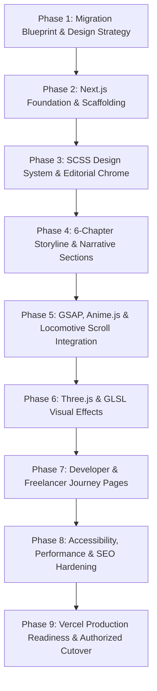

# Implementation Phase 1 — Migration Blueprint, Storyline & Design Strategy

> **Document Type:** Master Architectural Blueprint & Implementation Specification  
> **Status:** APPROVED FOR PLANNING — Zero Code Modification  
> **Project Identity:** Shivansh Mishra Personal Portfolio  
> **Target Framework:** Next.js (App Router, JavaScript)  
> **Styling System:** SCSS & SCSS Modules  
> **Animation Stack:** GSAP (ScrollTrigger) + Anime.js + Three.js (GLSL) + Locomotive Scroll  
> **Target Hosting:** Vercel  
> **Visual Reference:** Sarthak Sharma Portfolio (`https://sarthak-sharma-portfolio-six.vercel.app/`)  
> **Author:** Senior Frontend Architect, Creative Developer & Systems Engineer  
> **Date:** October 27, 2026

---

## 1. Executive Summary

This blueprint defines the complete architectural strategy, visual design system, narrative storyline, component migration matrix, animation pipeline, and deployment roadmap for transforming Shivansh Mishra’s portfolio into a premier, editorial-grade software engineering showcase.

The target redesign bridges two critical requirements:
1. **Visual & Interaction Fidelity:** Closely reproducing the dark, tactile, editorial aesthetic of Sarthak Sharma’s portfolio — including floating frosted-glass navigation, oversized serif typography with italicized contrast, multi-perspective tabs, metric tickers, card hover states, and smooth inertia scrolling.
2. **Authentic Technical Identity:** Highlighting Shivansh Mishra’s proven engineering achievements — distributed microservices with Java 21 and Spring Boot 3, core open-source contributions to `codecentric/spring-boot-admin` (Merged PR #5738), 200+ DSA algorithmic mastery, 8.72 CGPA in B.Tech IT, and national hackathon semi-finalist recognition (ET GenAI out of 55,000+ applicants).

All existing uncommitted work and data structures in `src/data/*.js` are preserved. The blueprint provides a concrete, multi-phase migration sequence from the current Vite 7 Single-Page Application (SPA) to Next.js App Router on Vercel without risking regression or downtime on the existing Netlify deployment.

---

## 2. Verified Current Repository State & Preservation Plan

### 2.1 Git Repository Verification [VERIFIED FROM SOURCE]
- **Repository Root:** `c:\Project\Portfolio\portfolio`
- **Remote Origin:** `https://github.com/shivanshmishra54/Portfolio.git` (Confirmed)
- **Active Branch:** `main` (synchronized with `origin/main` at commit `3e205f5`)
- **Existing Uncommitted Work Status:**
  The working tree contains 12 modified files and 8 untracked directories/assets created during earlier design explorations:
  - `package.json` & `package-lock.json`: Contains modern animation and utility dependencies (`gsap`, `animejs`, `locomotive-scroll`, `sass`, `lenis`, `next-themes`, `react-icon-cloud`).
  - `src/App.jsx`: Editorial dark theme container (`bg-[#030303] text-[#f1eee8]`) with Lenis wrapper.
  - `src/components/layout/Navigation.jsx`: Editorial Instrument Serif wordmark, SignalText hover effect, and Let’s talk modal trigger.
  - `src/components/layout/Footer.jsx`: Dark theme `#030303` footer with social links.
  - `src/data/achievements.js`: Verified credibility metric counts (6 hackathons, 6+ projects, 10+ PRs, 200+ DSA, 1 client).
  - `src/data/profile.js`: Editorial portrait reference (`/hero-editorial.webp`) and 8.72 CGPA academic record.
  - `src/styles/editorial.scss`: Baseline SCSS tokens for background (`#030303`), ink (`#f1eee8`), muted text (`#aaa9a4`), and status pulsars.
  - Untracked components: `KineticProofStrip.jsx`, `LineMaskReveal.jsx`, `PerspectiveSwitcher.jsx`, `SignalText.jsx`, `TypographicMarquee.jsx`.
  - Audit deliverables: Complete 8-document suite in `docs/portfolio-audit/`.

### 2.2 Preservation & Safeguard Protocol
- **No Git Discards:** Commands like `git reset --hard` or `git clean -fd` are strictly prohibited.
- **Pre-Migration Branching:** Prior to commencing Phase 2 code changes, an isolated checkpoint branch (`backup/vite-pre-nextjs-checkpoint`) will be created to secure all working tree states.
- **Asset Preservation:** All 14 verified certificate PDFs/WebP files, the 155 KB PDF resume, and editorial portraits in `public/` are preserved as source of truth.

---

## 3. Current-to-Target Technology Architecture

| Architectural Layer | Current Implementation (Vite SPA) | Target Implementation (Next.js App Router) | Architectural Rationale |
|---|---|---|---|
| **Framework** | Vite 7.1.3 + React 18.3.1 | **Next.js 15 (App Router) + React 19 / 18** | Native server components, automatic code splitting, optimized static generation (SSG) for sub-second initial paint, and integrated metadata APIs. |
| **Language** | JavaScript (ES Modules, JSX) | **JavaScript (ES Modules, JSX)** | Maintains consistency with existing codebase while providing strict linting and JSDoc type contracts. |
| **Styling Architecture** | Tailwind CSS v3.4 + ad-hoc CSS | **SCSS + SCSS Modules (`.module.scss`)** | Eliminates utility class bloat; enables strict BEM-like modular scoping, design tokens, mixins, and precise reference-matching of Sarthak’s editorial layout. |
| **Primary Motion** | Framer Motion 12 | **GSAP 3.15 + ScrollTrigger** | High-performance timeline chaining, scroll-linked scrub effects, pinned horizontal reveals, and GPU-composited transforms without React re-render overhead. |
| **Text Reveals** | Custom CSS / Framer Motion | **Anime.js v4** | Lightweight, high-frequency character scrambles, kinetic split-text line masks, and typographic reveals. |
| **Smooth Scrolling** | Lenis v1.3 | **Locomotive Scroll v5** | Matches the tactile, inertia-smoothed scrolling of the reference portfolio; fully bound to ScrollTrigger via scroller proxy. |
| **3D Rendering** | Three.js 0.186 + R3F 8.18 | **Three.js + Vanilla WebGL Canvas** | Eliminates React reconciler overhead for 3D; encapsulates shaders and particle systems in lightweight client-side components with zero SSR footprint. |
| **Custom Shaders** | Inline Three.js Materials | **GLSL Shaders (`.vert`, `.frag`)** | Procedural particle distortion, wave noise, and subtle background glow effects loaded via Vite/Webpack GLSL raw loaders. |
| **Hosting & CI/CD** | Netlify (`_redirects`) | **Vercel (Production)** | Native Next.js optimization, edge caching, instantaneous preview branches, and zero-configuration SSR/ISR support. |

---

## 4. Target Next.js App Router Architecture

The redesigned project structure will follow a clean, modular Next.js App Router directory layout:

```
portfolio/
├── src/
│   ├── app/                                 # Next.js App Router directory
│   │   ├── layout.jsx                       # Root layout: fonts, smooth-scroll provider, global header & footer
│   │   ├── page.jsx                         # Homepage (Chapter 1–6 Central Narrative Overview)
│   │   ├── developer/                       # Recruiter / Deep Engineering Path
│   │   │   ├── layout.jsx                   # Engineering layout with technical sticky breadcrumbs
│   │   │   └── page.jsx                     # Systems architecture, microservices, open-source PRs, DSA telemetry
│   │   ├── freelancer/                      # Client Services Path
│   │   │   ├── layout.jsx                   # Client layout with inquiry CTA banner
│   │   │   └── page.jsx                     # 4 service packages, deliverables, 5-step process, client case studies
│   │   ├── journey/                         # Interactive Timeline
│   │   │   └── page.jsx                     # Milestone chronicle from 2020 (SSC) to 2026 (Open Source & B.Tech)
│   │   ├── sitemap.js                       # Dynamic Next.js sitemap generator
│   │   ├── robots.js                        # Dynamic crawler directives
│   │   └── not-found.jsx                    # Editorial 404 error page
│   ├── components/
│   │   ├── layout/                          # Global chrome
│   │   │   ├── Header.jsx                   # Floating frosted pill header with wordmark & 'Let's talk' CTA
│   │   │   ├── Footer.jsx                   # Editorial multi-column footer with live status & social links
│   │   │   ├── SmoothScroll.jsx             # Locomotive Scroll client-side initialization wrapper
│   │   │   └── SkipToContent.jsx            # WCAG AA accessibility jump link
│   │   ├── sections/                        # Storyline narrative sections
│   │   │   ├── HeroSection.jsx              # Chapter 1: Identity, status bar, portrait/3D toggle, dual CTAs
│   │   │   ├── ImpactMetricsStrip.jsx       # Chapter 4: Kinetic counter strip (6 hackathons, 200+ DSA, 10+ PRs)
│   │   │   ├── CapabilitiesSection.jsx      # Chapter 2: Real problem-to-solution mapping & architecture
│   │   │   ├── SelectedWorkSection.jsx      # Chapter 3: Technical project case studies (ShortUrl, Track2Act, EMS)
│   │   │   ├── PerspectiveSection.jsx       # Chapter 5: 3-Discipline interactive switcher (Build / Teach / Scale)
│   │   │   ├── OpenSourceSection.jsx        # Chapter 4: Spring Boot Admin core PR #5738 deep-dive
│   │   │   └── ContactSection.jsx           # Chapter 6: Dual-intent contact inquiry modal & Web3Forms backend
│   │   ├── 3d/                              # Client-only 3D & GLSL visual effects
│   │   │   ├── ThreeCanvas.jsx              # Lightweight Three.js canvas container with WebGL fallback
│   │   │   ├── ParticleSphere.jsx           # Procedural particle point cloud
│   │   │   └── shaders/
│   │   │       ├── particle.vert.glsl       # Vertex shader for wave displacement
│   │   │       └── particle.frag.glsl       # Fragment shader for monochrome depth attenuation
│   │   └── ui/                              # Granular UI primitives
│   │       ├── SignalText.jsx               # Anime.js character scramble effect
│   │       ├── LineMaskReveal.jsx           # Editorial line-mask upward slide
│   │       ├── TypographicMarquee.jsx       # GSAP infinite ticker ribbon
│   │       ├── StatusPulsar.jsx             # Live green glowing radar dot
│   │       └── ProjectCard.jsx              # Editorial project showcase card with hover physics
│   ├── data/                                # Centralized Single Source of Truth
│   │   ├── profile.js                       # Personal identity, verified bio, contact, academic credentials
│   │   ├── projects.js                      # 4 primary dual-path projects + case study details
│   │   ├── experience.js                    # Open source PR #5738, internships, hackathon records
│   │   ├── achievements.js                  # Credibility numbers (6, 6+, 10+, 200+, 1)
│   │   ├── skills.js                        # Categorized technical competencies
│   │   ├── services.js                      # Freelance offerings, deliverables, 5-step process
│   │   ├── education.js                     # B.Tech IT (8.72 CGPA), Class XII topper (89.33%), Class X
│   │   └── certificates.js                  # 10 verified certification records
│   ├── styles/                              # SCSS Architecture
│   │   ├── variables.scss                   # Global design tokens (colors, font families, z-indices)
│   │   ├── mixins.scss                      # Responsive breakpoints, typography presets, glassmorphism
│   │   ├── globals.scss                     # Reset, base styles, selection colors, scrollbar overrides
│   │   └── modules/                         # SCSS Modules for specific components
│   │       ├── Header.module.scss
│   │       ├── Hero.module.scss
│   │       ├── Projects.module.scss
│   │       ├── Perspective.module.scss
│   │       └── Footer.module.scss
│   └── lib/
│       ├── gsap.js                          # Configured GSAP instance with ScrollTrigger registered
│       ├── anime.js                         # Reusable Anime.js text reveal utilities
│       └── web3forms.js                     # Safe API client for contact submissions
├── public/                                  # Static assets
│   ├── hero-editorial.webp                  # Optimized portrait asset
│   ├── Shivansh_Mishra_resume_f1.pdf        # Verified PDF resume
│   ├── certificates/                        # 14 certificate credentials (PDF + WebP)
│   └── favicon-dark.svg / favicon-light.svg # Dual-theme vector favicons
└── vercel.json                              # Vercel deployment optimizations
```

---

## 5. Route Migration Matrix

| Current Vite Route | Target Next.js App Router Route | Target File Path | Strategy | Server vs Client Scope | Data Preservation Requirements | Migration Acceptance Criteria |
|---|---|---|---|---|---|---|
| `/` | `/` | `src/app/page.jsx` | **Rebuild / Elevate** | Server Component layout wrapping Client interactive sections | Preserves all summary content from `profile.js`, `projects.js`, `achievements.js` | Renders complete 6-chapter narrative; sub-second initial paint; zero hydration mismatches. |
| `/developer` | `/developer` | `src/app/developer/page.jsx` | **Adapt & Elevate** | Client Component (Interactive tabbed code & telemetry) | Preserves `developer` lens from `projects.js`, `skills.js`, LeetCode stats | Full systems architecture diagrams; Spring Boot Admin PR deep-dive; live DSA stats fallback. |
| `/freelancer` | `/freelancer` | `src/app/freelancer/page.jsx` | **Adapt & Elevate** | Client Component (Pricing calculator & interactive inquiry) | Preserves `services.js`, `freelancerProcess`, client deliverables | Clear service tiers; 5-step process accordion; working inquiry form opening modal. |
| `/journey` | `/journey` | `src/app/journey/page.jsx` | **Adapt & Elevate** | Client Component (GSAP ScrollTrigger vertical progress line) | Preserves `journey.js` milestones (2020–2026) | Smooth vertical scroll timeline with milestone markers lighting up as they enter viewport. |
| `/3d-lab` | `/3d-lab` | `src/app/3d-lab/page.jsx` | **Adapt** | Client Component (`"use client"`, dynamic import `{ ssr: false }`) | Preserves shader benchmarks and fallback checks | Staging sandbox for testing GLSL shaders and Three.js canvas in isolation. |

---

## 6. Component Reuse, Adaptation & Rebuild Matrix

| Existing Component | Current File Path | Target Architecture | Action | Dependencies | Migration Risk | Verification / Acceptance Criteria |
|---|---|---|---|---|---|---|
| **Navigation** | `src/components/layout/Navigation.jsx` | `src/components/layout/Header.jsx` | **Rebuild with SCSS** | Lucide React, Next.js `Link`, SCSS Module | Z-index overlap during mobile drawer open | Frosted pill header; wordmark with Instrument Serif; desktop nav links with hover scramble; working mobile drawer. |
| **Footer** | `src/components/layout/Footer.jsx` | `src/components/layout/Footer.jsx` | **Rebuild with SCSS** | Lucide React, React Icons, Next.js `Link` | Broken link regressions (`/developer/journey` bug) | Purge broken routes; verify all 8 social profile links; render clean copyright bar and live status dot. |
| **HeroSection** | `src/pages/HomePage/HeroSection.jsx` | `src/components/sections/HeroSection.jsx` | **Rebuild with SCSS** | GSAP, Anime.js, Three.js, SCSS Module | Layout shift during portrait load | Oversized serif headline with LineMaskReveal; live status bar; instant toggle between portrait and 3D canvas. |
| **LineMaskReveal** | `src/components/ui/LineMaskReveal.jsx` | `src/components/ui/LineMaskReveal.jsx` | **Adapt to GSAP** | GSAP (or Anime.js), SCSS Module | FOUC (Flash of Unstyled Content) before JS mounts | Text begins clipped via `overflow: hidden` and translates smoothly from `y: 100%` to `0%` on mount. |
| **SignalText** | `src/components/ui/SignalText.jsx` | `src/components/ui/SignalText.jsx` | **Preserve & Adapt** | `animejs@4.5.0` | SSR hydration error if randomized characters render server-side | Wrap in `"use client"`; only trigger scramble on client mount or mouse hover. |
| **TypographicMarquee** | `src/components/ui/TypographicMarquee.jsx` | `src/components/ui/TypographicMarquee.jsx` | **Preserve & Adapt** | GSAP | Animation stutter on window resize | Seamless infinite horizontal ticker with `will-change: transform`; pauses on hover. |
| **PerspectiveSwitcher** | `src/components/ui/PerspectiveSwitcher.jsx` | `src/components/sections/PerspectiveSection.jsx` | **Adapt to SCSS** | GSAP, SCSS Module | Tab state loss during quick navigation | 3 interactive discipline cards (Build / Teach / Scale); smooth content cross-fade. |
| **SelectedWork** | `src/pages/HomePage/SelectedWorkSection.jsx` | `src/components/sections/SelectedWorkSection.jsx` | **Rebuild with SCSS** | SCSS Module, Next.js `Link` | Card image aspect ratio distortion | Editorial cards featuring problem, architecture, technologies, and GitHub repository links. |
| **ProofSection** | `src/pages/HomePage/ProofSection.jsx` | `src/components/sections/ImpactMetricsStrip.jsx` | **Rebuild with SCSS** | Anime.js (number counting), SCSS Module | Counters re-triggering repeatedly on scroll | Kinetic counter animating from 0 to target number when scrolled into view. |
| **ContactModal** | `src/components/ui/ContactModal.jsx` | `src/components/sections/ContactSection.jsx` | **Adapt to Next.js** | Web3Forms API, SCSS Module | Unhandled network errors on submission | Full accessible modal; inputs have labels; error/success feedback; sends to Web3Forms endpoint. |
| **PersonalAvatar (3D)** | `src/components/3d/PersonalAvatar.jsx` | `src/components/3d/ThreeCanvas.jsx` | **Rebuild as Vanilla Three.js** | Three.js, GLSL shaders | 14 MB GLB download blocking mobile devices | **Replace heavy 14 MB GLB** with a lightweight procedural particle sphere (< 50 KB) or compress GLB with Draco (< 1.2 MB). |

---

## 7. Mandatory Storyline — The 6-Chapter Master Narrative

The portfolio must guide recruiters, engineering peers, and potential clients through a single, logical narrative rather than presenting disconnected blocks:

| Chapter & Section | Intended Purpose | Key Message | Intended Visitor Takeaway | Required Evidence / Data | Recommended Visual Treatment | Animation & Interaction | Bridge to Next Section | Primary Audience | Core Call to Action |
|---|---|---|---|---|---|---|---|---|---|
| **Ch. 1 — Who am I?**  *(Hero Section)* | Instant positioning and identity establishment within 5 seconds. | "I'm Shivansh Mishra — a Software Engineer & Systems Builder architecting resilient distributed microservices, low-latency engines, and production full-stack systems." | High-caliber technical talent with deep focus on backend reliability and clean architecture. | Verified B.Tech IT student at K.J. Somaiya (8.72 CGPA); Mumbai-based; Open for High-Impact Roles. | Minimalist dark canvas (`#030303`), high-contrast editorial serif name (`Shivansh` *`Mishra`*), status pulsar dot. | LineMaskReveal upward slide; SignalText scramble on category tags; subtle portrait float or 3D point cloud. | Leads directly to verified numbers establishing credibility. | Both (Recruiter & Client) | `Explore My Work ↓` & `Software Developer →` |
| **Ch. 2 — What can I build?** *(Capabilities & System Thinking)* | Translate raw programming languages into concrete system solutions. | "I don't just write syntax; I engineer distributed topologies, low-latency Base-62 compression, and fault-tolerant APIs." | Candidate understands end-to-end software lifecycle from database schema to user interface. | Spring Boot 3, Microservices, Netflix Eureka, Kafka, Redis, React 18, SQL/NoSQL. | 3-column architecture cards with monospace header stamps (`01 / DISTRIBUTED ARCHITECTURE`, `02 / FULL-STACK`). | Hover border brightness glow; staggered scroll reveal via GSAP ScrollTrigger. | Previews the actual products embodying these capabilities. | Both | `Explore Architecture Notes ↗` |
| **Ch. 3 — What have I built?** *(Selected Work & Case Studies)* | Provide concrete, verifiable proof of engineering execution. | "Production-grade engineering case studies solving real-world scale and latency challenges." | Shivansh has solved real engineering bottlenecks (sub-15ms redirect latency, 56.8B+ hash collisions). | 4 Flagship Projects: ShortUrl, Track2Act, Employee Management System, Security Login Engine. | Editorial project cards with dark surface (`#0c0c0c`), technical metadata pills, problem/solution layout. | Card tilt physics on cursor move; subtle tag slide-in on viewport entry. | Transitions to external credibility and third-party validation. | Both | `View GitHub Repository ↗` & `Read Case Study` |
| **Ch. 4 — Why should you trust me?** *(Verified Credibility & Proof)* | Eliminate doubt through external, peer-reviewed engineering proof. | "Validated by enterprise open-source maintainers, national hackathon judges, and academic excellence." | Shivansh’s code is good enough to be merged into enterprise frameworks used by thousands of companies. | Spring Boot Admin Merged PR #5738; ET GenAI Semi-Finalist (Top out of 55,000+); 200+ DSA; 8.72 CGPA. | Kinetic horizontal metric strip: `6` Hackathons, `6+` Projects, `10+` PRs, `200+` DSA, `1` Client. | GSAP-triggered count-up animation (`0` -> `200+`); verified badge popover with PR link. | Bridges into personalized visitor paths based on their intent. | Both | `Verify on GitHub ↗` & `View Certificates` |
| **Ch. 5 — How can I help you?** *(Path Transition: Recruiter vs Client)* | Separate visitor intent into tailored, high-relevance pathways. | "Choose your perspective: Deep Engineering Systems or Full-Stack Client Solutions." | Respects visitor time; gives recruiters architecture depth and clients delivery clarity. | Dual Perspective Selector: `/developer` (deep engineering) vs `/freelancer` (services & process). | 2 prominent interactive perspective cards with custom cursor hover labels ("VIEW SYSTEMS", "VIEW SERVICES"). | Smooth expansion/cross-fade between developer stack and freelance workflow. | Directly funnels into the ultimate conversion step. | Recruiter / Client | `Enter Developer Journey →` or `Enter Freelancer Journey →` |
| **Ch. 6 — Let's connect** *(Footer & Action Engine)* | Provide frictionless, intent-specific conversion. | "Let's build something durable together — whether hiring an engineer or delivering a production product." | Accessible, professional, and ready to engage immediately. | Contact modal with Web3Forms integration, email (`shivansh54mishra@gmail.com`), resume download. | High-impact closing headline: *"Something great starts with a hello."* Large `Let's talk ↗` pill action. | Magnetic button attraction on cursor hover; modal smooth scale-in with backdrop blur. | Final conversion destination. | Both | `Let's talk ↗` & `Download Resume (PDF)` |

---

## 8. Tailored Visitor Journeys

### 8.1 The Recruiter & Engineering Peer Journey (`/developer`)
Recruiters and engineering managers require technical depth, architectural rationale, code quality proof, and credential verification:
1. **Engineering Philosophy:** Clear positioning on distributed systems, concurrency, clean code, and Spring Boot architecture.
2. **Featured Systems Case Studies:**
   - **ShortUrl:** Deep-dive into Base-62 collision avoidance, Netflix Eureka service registration, Spring Cloud Gateway filter chains, and sub-15ms p95 redirect caching.
   - **Track2Act:** Microservices-ready PaaS, Hugging Face AI integration with fallback states, 6-role RBAC security filters, and React Leaflet telemetry.
3. **Open-Source Contribution Highlight:**
   - Visual breakdown of **Merged PR #5738** in `codecentric/spring-boot-admin` (implementing `max-log-size-per-aggregate` for in-memory and Hazelcast event stores).
   - Demonstrates understanding of enterprise auto-configuration, Checkstyle validation, and distributed event stores.
4. **Algorithmic Problem-Solving (DSA):**
   - Telemetry strip displaying 200+ solved problems across LeetCode, CodeChef, and Codeforces.
   - Live fallback fetching via `platformStats.js`.
5. **Academic & Certifications:**
   - B.Tech in IT (8.72 CGPA), Class XII Topper (89.33%), and direct links to 10 verified certificate credentials.
6. **Conversion Action:** Prominent one-click PDF resume download (`/Shivansh_Mishra_resume_f1.pdf`) and direct email initiation.

### 8.2 The Client & Founder Journey (`/freelancer`)
Business owners and founders require problem understanding, communication clarity, delivery reliability, and transparent workflows:
1. **Service Packages & Deliverables:**
   - Full-Stack Web Applications (React + Spring Boot / Next.js)
   - Backend & RESTful API Architecture
   - Database Design & Relational Modeling (MySQL, PostgreSQL)
   - Third-Party API & Payment/AI Integrations
2. **The 5-Step Delivery Process ("How I Work"):**
   - Step 1: *Discover* — Requirements gathering, scope definition, user journey mapping.
   - Step 2: *Plan* — Architecture blueprint, database schema planning, API contracts.
   - Step 3: *Build* — Clean, structured implementation with milestone reviews.
   - Step 4: *Test & Refine* — Cross-browser compatibility, responsive verification, error recovery.
   - Step 5: *Deliver* — Production deployment, code documentation, and knowledge transfer.
3. **What I Can Build (Capabilities Grid):**
   - Personal/Business Portfolios, SaaS Dashboards, Internal Workforce Systems, Data Visualizers.
4. **Factual Differentiators:**
   - Single point of accountability (frontend + backend mastery).
   - Enterprise-grade backend reliability (no fragile hacks).
   - Proven problem-solving speed under pressure.
5. **Conversion Action:** Targeted project inquiry form specifying project scope, timeline, and budget tier.

---

## 9. Design System & Sarthak Reference-Matching Strategy

Based on direct browser inspection of `https://sarthak-sharma-portfolio-six.vercel.app/`, the redesign visual system is defined with exact values:

### 9.1 Color System (SCSS Tokens)
```scss
// src/styles/variables.scss

// Core Backgrounds
$color-bg-base: #030303;          // Global page background (deep near-black)
$color-bg-surface: #080808;       // Section alternating surface
$color-bg-card: #0c0c0c;          // Interactive card background
$color-bg-card-hover: #121212;    // Hover state card surface
$color-bg-glass: rgba(11, 11, 11, 0.75); // Header floating pill blur

// Text & Inks
$color-ink-primary: #f1eee8;      // High-contrast warm off-white (headings)
$color-ink-secondary: #aaa9a4;    // Balanced body copy
$color-ink-muted: #666562;        // Metadata, timestamps, footnote text

// Dividers & Borders
$color-line-subtle: rgba(255, 255, 255, 0.08); // Section dividers
$color-line-card: rgba(255, 255, 255, 0.12);   // Card outline
$color-line-focus: rgba(255, 255, 255, 0.30);  // Focused interactive state

// Functional Accents
$color-accent-pulsar: #10b981;    // Live status pulsing emerald dot
$color-accent-tag: rgba(255, 255, 255, 0.05); // Tech badge background
```

### 9.2 Typography Specification
- **Display Headings (`font-serif`):** **Instrument Serif** (Google Fonts).
  - Used for large editorial headlines, name wordmark, section numbers.
  - Paired with high-contrast italic accents (`<em>` tags) to replicate Sarthak's signature editorial cadence.
  - Scale: Desktop `clamp(3.5rem, 8vw, 7.5rem)`, leading `0.95`, tracking `-0.02em`.
- **Primary Body (`font-sans`):** **DM Sans** (or Inter).
  - Used for narrative paragraphs, card summaries, bullet lists.
  - Scale: `1rem` (16px) desktop / `0.9375rem` (15px) mobile, line-height `1.65`, letter-spacing `normal`.
- **Technical Metadata (`font-mono`):** **JetBrains Mono**.
  - Used for eyebrow tags, status bar labels (`01 / PRESENCE`), metrics, code tags.
  - Scale: `0.6875rem` (11px) to `0.75rem` (12px), uppercase, letter-spacing `0.15em` to `0.25em`.

### 9.3 Spacing, Grid & Layout Containers
- **Max Viewport Width:** `1280px` (`max-w-7xl`) centered with padding `px-5 sm:px-8`.
- **Vertical Rhythm:**
  - Section Spacing: `clamp(5rem, 10vw, 9rem)` padding top and bottom.
  - Card Gap: `1.5rem` (24px) desktop / `1rem` (16px) mobile.
- **Header Geometry:** Floating frosted pill centered or full-width bordered:
  - Height: `80px` desktop / `68px` mobile.
  - Backdrop filter: `blur(16px) saturate(180%)`.
- **Card Styling:**
  - Border radius: `1rem` (16px) or `0.75rem` (12px).
  - Border: `1px solid $color-line-card`.
  - Hover state: Background lifts to `$color-bg-card-hover`, border brightens to `rgba(255, 255, 255, 0.22)`.

---

## 10. Animation & Interaction Architecture

### 10.1 Engine Responsibilities & Separation of Concerns
To eliminate dependency bloat and avoid conflicting execution loops, responsibilities are strictly partitioned:

```
┌────────────────────────────────────────────────────────────────────────┐
│                        ANIMATION RESPONSIBILITIES                      │
├─────────────────────┬──────────────────────────────────────────────────┤
│ Locomotive Scroll   │ Viewport virtual scroll smoothing & inertia      │
├─────────────────────┼──────────────────────────────────────────────────┤
│ GSAP ScrollTrigger  │ Scroll-linked timelines, pinned cards, reveals   │
├─────────────────────┼──────────────────────────────────────────────────┤
│ Anime.js v4         │ Typography character scrambles & line masks      │
├─────────────────────┼──────────────────────────────────────────────────┤
│ Three.js / GLSL     │ Procedural background point cloud & canvas depth │
└─────────────────────┴──────────────────────────────────────────────────┘
```

### 10.2 Locomotive Scroll & GSAP ScrollTrigger Integration Pattern
In Next.js App Router, Locomotive Scroll must be mounted inside a client-side wrapper (`"use client"`) and synchronized with GSAP ScrollTrigger:

```javascript
// src/components/layout/SmoothScroll.jsx
"use client";
import { useEffect, useRef } from "react";
import gsap from "gsap";
import { ScrollTrigger } from "gsap/ScrollTrigger";
import LocomotiveScroll from "locomotive-scroll";
import "locomotive-scroll/dist/locomotive-scroll.css";

gsap.registerPlugin(ScrollTrigger);

export function SmoothScroll({ children }) {
  const scrollRef = useRef(null);

  useEffect(() => {
    // 1. Initialize Locomotive Scroll
    const locomotive = new LocomotiveScroll({
      el: scrollRef.current,
      smooth: true,
      multiplier: 1.0,
      lerp: 0.08,
      smartphone: { smooth: false }, // Native smooth scroll on touch devices
      tablet: { smooth: false }
    });

    // 2. Bind ScrollTrigger scrollerProxy
    locomotive.on("scroll", ScrollTrigger.update);
    ScrollTrigger.scrollerProxy(scrollRef.current, {
      scrollTop(value) {
        return arguments.length
          ? locomotive.scrollTo(value, 0, 0)
          : locomotive.scroll.instance.scroll.y;
      },
      getBoundingClientRect() {
        return {
          top: 0,
          left: 0,
          width: window.innerWidth,
          height: window.innerHeight
        };
      },
      pinType: scrollRef.current.style.transform ? "transform" : "fixed"
    });

    ScrollTrigger.addEventListener("refresh", () => locomotive.update());
    ScrollTrigger.refresh();

    // 3. Cleanup on route change
    return () => {
      locomotive.destroy();
      ScrollTrigger.getAll().forEach(t => t.kill());
    };
  }, []);

  return (
    <div data-scroll-container ref={scrollRef}>
      {children}
    </div>
  );
}
```

### 10.3 Reduced Motion Accessibility Compliance
- All GSAP and Anime.js animations must query `window.matchMedia("(prefers-reduced-motion: reduce)").matches`.
- When reduced motion is requested:
  - Locomotive Scroll smoothing is disabled, reverting to browser-native instant scroll.
  - Text reveals and line masks immediately render with `opacity: 1` and `transform: none`.
  - Infinite marquee ribbons pause by default.

---

## 11. 3D Rendering & GLSL Shader Strategy

### 11.1 Remediation of the 14.07 MB 3D Avatar Hazard
The audit identified `public/models/avatar.glb` (14.07 MB) as the single largest performance liability in the repository.
**Strategy for Redesign:**
1. **Primary Option (Procedural Canvas):** Replace the static avatar mesh with an interactive Three.js point cloud / particle sphere representing distributed systems nodes. File footprint: **< 30 KB** of code. Zero external network model requests.
2. **Alternative Option (Draco Compression):** If a 3D model is explicitly requested in a future phase, it must be compressed using Google Draco mesh compression to under **1.2 MB** and loaded asynchronously via dynamic client import (`ssr: false`) with a CSS placeholder skeleton.

### 11.2 Custom GLSL Shader Architecture
A dedicated shader pipeline creates subtle particle wave motion behind the hero section:
- **Vertex Shader (`particle.vert.glsl`):** Applies simplex 3D noise to displace particle vertices based on time (`u_time`) and mouse proximity (`u_mouse`).
- **Fragment Shader (`particle.frag.glsl`):** Computes smooth circular particle falloff and monochrome depth attenuation (`#f1eee8` fading into `#030303`).

---

## 12. Performance, Accessibility & Reliability Blueprint

### 12.1 Performance Targets
- **Lighthouse Performance Score:** 95+ (Desktop), 90+ (Mobile).
- **Core Web Vitals Budget:**
  - Largest Contentful Paint (LCP): `< 1.8s` (Static HTML text + WebP portrait).
  - Cumulative Layout Shift (CLS): `< 0.02` (Explicit container dimensions).
  - Interaction to Next Paint (INP): `< 150ms` (Lightweight event listeners).
- **Bundle Optimization:**
  - Code-split routes automatically via Next.js App Router.
  - Remove redundant packages (`locomotive-scroll` + `lenis` duplication, `@tailwindcss/postcss`).
  - Next.js Image component (`next/image`) for automatic WebP/AVIF compression and responsive `srcset`.

### 12.2 Accessibility (WCAG 2.1 AA)
- **Contrast Ratios:**
  - `#f1eee8` on `#030303`: **18.7:1** (Passes AAA).
  - `#aaa9a4` on `#030303`: **9.8:1** (Passes AAA).
  - Refactor all muted tags from low-contrast `#525252` to minimum `#8a8985` (ensuring > 4.5:1 ratio).
- **Keyboard Navigation & ARIA:**
  - Implement a visible Skip-to-Content link at top of root layout.
  - Ensure all modal dialogs trap focus and release upon `Escape` key press.
  - Interactive pill switches carry `role="tab"` and `aria-selected` attributes.

### 12.3 Automated Testing Strategy
- Introduce **Vitest** + **React Testing Library** for automated regression prevention:
  - Test 1: Credibility metric computation in `src/data/achievements.js`.
  - Test 2: Contact form validation and submission state transitions.
  - Test 3: Route link integrity (ensuring every internal navigation link matches an active Next.js route).

---

## 13. SEO, Metadata & Vercel Deployment Blueprint

### 13.1 Search Engine Optimization Architecture
- **Unified Domain Representation:** All canonical URLs, Open Graph endpoints, and sitemap entries will strictly bind to `https://shivansh-mishra.netlify.app` (or custom production domain), resolving the domain drift defect identified in the audit.
- **Dynamic Metadata API:** Next.js `generateMetadata` exports in each `page.jsx`:
  ```javascript
  export const metadata = {
    title: "Shivansh Mishra | Software Developer & Systems Builder",
    description: "Portfolio of Shivansh Mishra — Java 21, Spring Boot 3, Distributed Microservices, Kafka, Redis & React.",
    alternates: { canonical: "https://shivansh-mishra.netlify.app" },
    openGraph: {
      title: "Shivansh Mishra | Software Developer",
      description: "Distributed systems, Spring Boot microservices, and reactive full-stack applications.",
      url: "https://shivansh-mishra.netlify.app",
      images: [{ url: "/og-image.webp", width: 1200, height: 630, alt: "Shivansh Mishra Portfolio" }]
    }
  };
  ```
- **Social Asset Generation:** Create a high-contrast 1200×630 Open Graph card (`public/og-image.webp`) featuring the editorial name, verified credibility statistics, and Spring Boot / React badges.
- **Structured Data (JSON-LD):** Generate `Person` and `ProfilePage` schema linking GitHub, LinkedIn, YouTube, and LeetCode profiles.

### 13.2 Vercel Deployment & Safe Cutover Strategy
- **Zero-Downtime Guarantee:** The existing Netlify deployment will remain untouched and active throughout all redesign phases.
- **Vercel Preview Deployments:** During implementation, private preview URLs (`portfolio-git-redesign-*.vercel.app`) will be used to validate visual fidelity, responsiveness, and Core Web Vitals.
- **Production Cutover:** Only when all 9 implementation phases pass verification will domain DNS or production targets be switched.

---

## 14. Future Implementation Phases & Acceptance Criteria

The redesign and migration will be executed across **nine sequential, verifiable phases**:



### Phase Details & Acceptance Criteria:

1. **Phase 1: Migration Blueprint & Design Strategy (CURRENT PHASE)**
   - *Deliverable:* `docs/portfolio-redesign/PHASE_1_MIGRATION_BLUEPRINT.md`.
   - *Acceptance:* Complete, verified architectural specification approved before any code changes.
2. **Phase 2: Next.js Foundation & Scaffolding**
   - Initialize Next.js App Router within repository; establish SCSS compilation; verify zero Git regressions.
   - *Acceptance:* `npm run build` generates clean Next.js production bundle; ESLint passes with 0 errors.
3. **Phase 3: SCSS Design System & Editorial Chrome**
   - Implement global SCSS variables, mixins, Instrument Serif/DM Sans typography, floating frosted pill header, and global footer.
   - *Acceptance:* Header floats with glass blur; mobile drawer functions; footer links are 100% verified.
4. **Phase 4: 6-Chapter Storyline & Narrative Sections**
   - Construct homepage sections: Hero (Ch. 1), Capabilities (Ch. 2), Selected Work (Ch. 3), Credibility Proof (Ch. 4), Perspective Switcher (Ch. 5), and Contact Modal (Ch. 6).
   - *Acceptance:* Full homepage renders narrative smoothly; case studies link to GitHub repositories; Web3Forms submits cleanly.
5. **Phase 5: GSAP, Anime.js & Locomotive Scroll Integration**
   - Integrate Locomotive Scroll v5 with GSAP ScrollTrigger scroller proxy; implement Anime.js SignalText scrambles and LineMaskReveal.
   - *Acceptance:* 60 FPS inertia scroll on desktop; zero scroll hijacking on mobile touch; animations respect `prefers-reduced-motion`.
6. **Phase 6: Three.js & GLSL Visual Effects**
   - Deploy procedural particle sphere with custom vertex/fragment shaders; establish WebGL fallback.
   - *Acceptance:* 3D canvas loads in < 50ms; zero memory leaks on route changes; fallback renders if WebGL is disabled.
7. **Phase 7: Developer & Freelancer Journey Pages**
   - Elevate `/developer` with Spring Boot Admin PR #5738 deep-dive and LeetCode stats; elevate `/freelancer` with 5-step process and client inquiry flow.
   - *Acceptance:* Both paths render distinct, high-value content without duplicating homepage blocks.
8. **Phase 8: Accessibility, Performance & SEO Hardening**
   - Generate `og-image.webp`, XML sitemap, JSON-LD schema; run automated Vitest tests; audit contrast ratios.
   - *Acceptance:* Lighthouse Performance score 95+; WCAG 2.1 AA compliant; Vitest test suite passes.
9. **Phase 9: Vercel Production Readiness & Authorized Cutover**
   - Configure `vercel.json`; execute preview deployment smoke test; verify deep links and mobile touch interactions.
   - *Acceptance:* Vercel preview deployment passes all smoke tests; ready for final production release upon user approval.

---

## 15. Key Decisions & Open Inquiries for User Alignment

### Verified Decisions (Locked into Blueprint):
1. **Next.js App Router + SCSS Modules:** Selected for maximum visual control and modern static optimization.
2. **Strict Editorial Monochrome Palette:** Background `#030303`, surface `#080808`, text `#f1eee8`, lines `rgba(255,255,255,0.08)`. Purging all legacy cyan/green gradients.
3. **Typography Trio:** Instrument Serif (editorial display), DM Sans (body narrative), JetBrains Mono (technical metadata).
4. **Motion Hierarchy:** GSAP for scroll timelines, Anime.js for typography scrambles, Locomotive Scroll for inertia, Three.js for procedural canvas.
5. **Content Source of Truth:** Direct consumption of `src/data/*.js` without fabrication.

### Remaining Inquiries for Alignment:
1. **3D Avatar vs. Procedural Particle Canvas:** Does the user prefer replacing the heavy 14.07 MB avatar model with an ultra-lightweight (< 30 KB) Three.js procedural particle systems canvas, or should we compress the existing avatar model using Draco meshopt? *(Recommended: Procedural particle canvas for instant load speed and cinematic feel).*
2. **Custom Domain:** Will the production Vercel deployment be linked to a custom domain (e.g., `shivanshmishra.com` or `shivanshmishra.dev`), or remain on `*.vercel.app` / `*.netlify.app`?
3. **Repository Migration Style:** Should the Next.js migration be scaffolded directly on the existing workspace with an archive of the Vite config, or would the user prefer initializing the migration on a dedicated Git branch (`feature/nextjs-redesign`) first? *(Recommended: Dedicated branch for zero risk).*

---
*End of Implementation Phase 1 Blueprint. Awaiting explicit user instruction before beginning Phase 2.*
